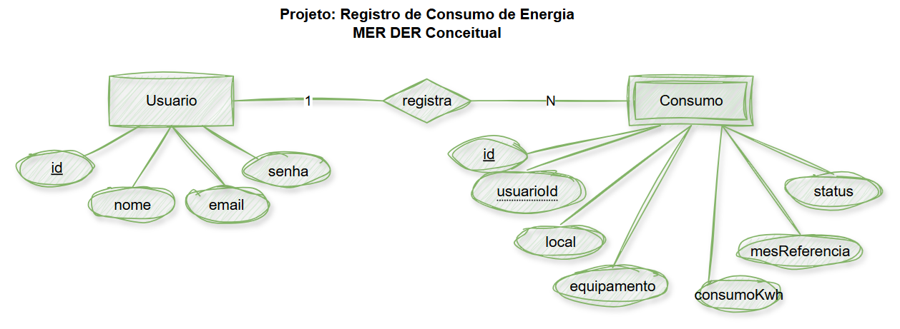
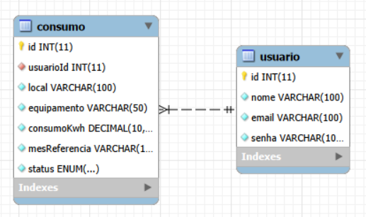
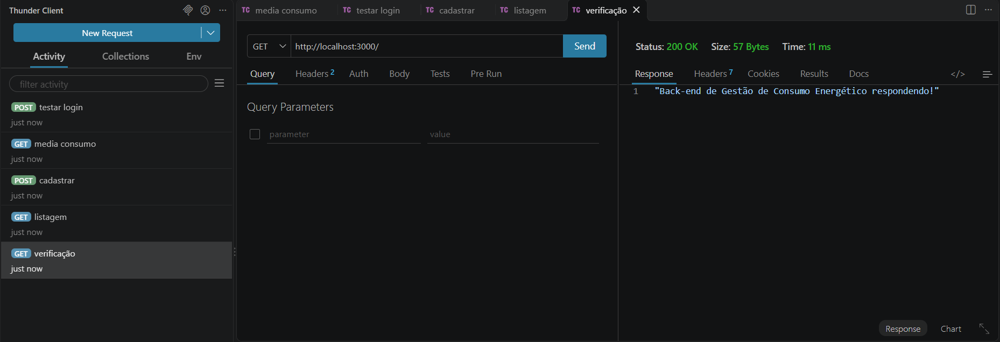
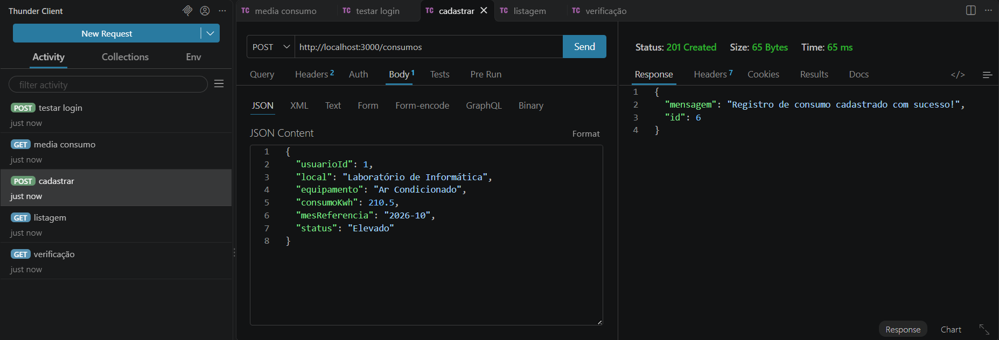
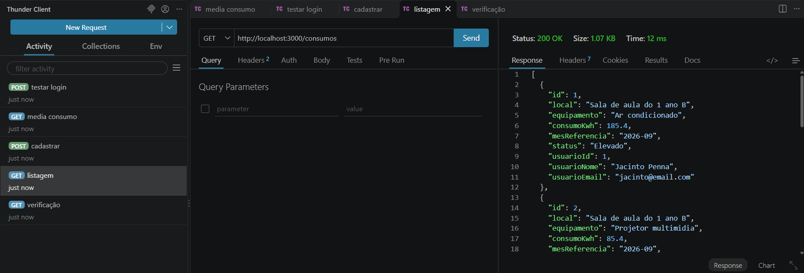
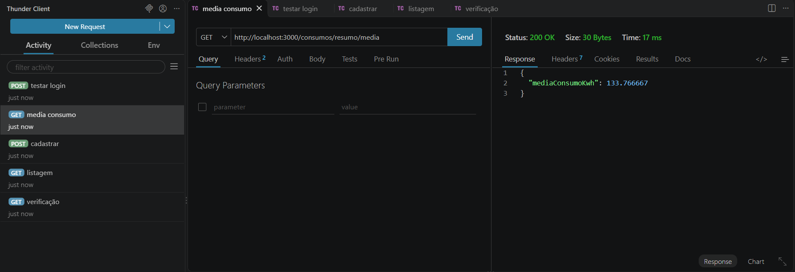
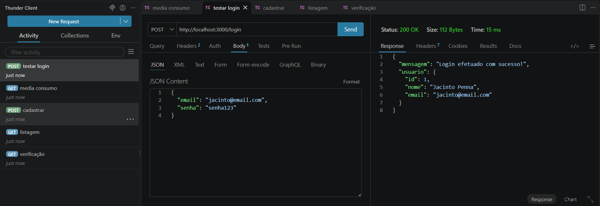

# Registro de Consumo de Energia

## Descrição

O projeto **Registro de Consumo de Energia** foi desenvolvido durante as aulas do curso de Desenvolvimento de Sistemas SENAI, atendendo a uma proposta institucional do SESI.

A aplicação consiste em uma API back-end desenvolvida em Node.js, utilizando a arquitetura MVC (Model-View-Controller) e integrada ao banco de dados MariaDB.

O sistema tem como finalidade registrar e acompanhar informações sobre o consumo de energia elétrica em diferentes ambientes e equipamentos, como salas de aula e laboratórios. Também permite gerenciar usuários, realizar autenticação por login e consultar métricas de consumo energético em kWh, auxiliando na identificação de possíveis desperdícios.

---

## Modelagem do Banco de Dados

A estrutura do banco de dados foi representada por meio de diagramas que demonstram as entidades, seus atributos e os relacionamentos entre as tabelas `usuario` e `ocorrencia`.

### mer_der_conceitual.png



### mer_der_logico.png



---

## Tecnologias Utilizadas

- **Node.js:** ambiente de execução JavaScript utilizado no desenvolvimento do back-end.
- **Express:** framework utilizado para estruturar e gerenciar as rotas da API.
- **MariaDB / MySQL:** banco de dados relacional utilizado para armazenar as informações.
- **XAMPP:** ferramenta utilizada para iniciar o serviço de banco de dados.
- **CORS:** middleware responsável pela configuração de acesso entre diferentes origens.
- **Thunder Client / Postman / Insomnia:** ferramentas utilizadas para testar as requisições da API.

---

## Como Executar o Projeto

### 1. Pré-requisitos

Para executar o projeto, é necessário possuir:

- Node.js instalado.
- XAMPP instalado.
- Visual Studio Code ou outro editor de código.

### 2. Configuração do Banco de Dados

1. Abra o painel de controle do XAMPP.
2. Inicie o serviço MySQL.
3. Abra o MySQL Workbench ou outra ferramenta de gerenciamento.
4. Localize e execute o script SQL do projeto:

```text
./db/sript.sql
```

### 3. Instalação das Dependências

Abra o terminal na pasta principal do projeto e execute:

```bash
npm install
```

### 4. Inicialização do Servidor

Após instalar as dependências, execute o comando:

```bash
npm run dev
```

O servidor estará disponível no endereço:

```text
http://localhost:3000
```

---

## Testes da API

Os testes foram realizados utilizando o Thunder Client, com o objetivo de verificar as rotas, validar as operações disponíveis e conferir a integração com o banco de dados.

### verificação.png



### cadastrar.png



### listagem.png



### consumomedio.png



### testelogin.png



---

## Objetivo do Desenvolvimento

A realização deste projeto possibilitou desenvolver conhecimentos práticos sobre programação back-end, criação e organização de APIs, arquitetura MVC, integração com bancos de dados relacionais, operações CRUD e autenticação de usuários.

Além do aprendizado técnico, o sistema apresenta uma aplicação da tecnologia no controle do consumo de energia elétrica, permitindo acompanhar informações importantes e contribuir para uma utilização mais consciente dos recursos energéticos.
